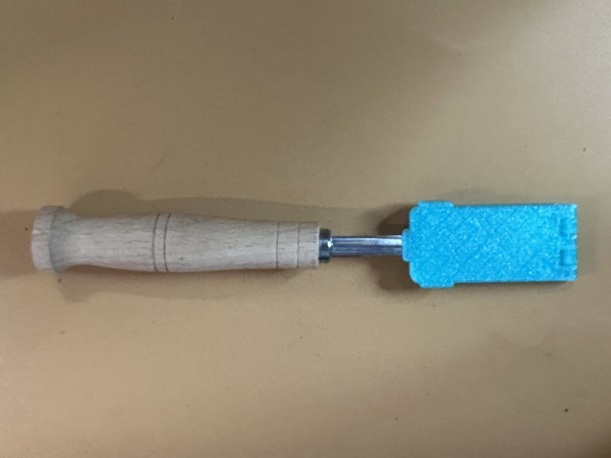
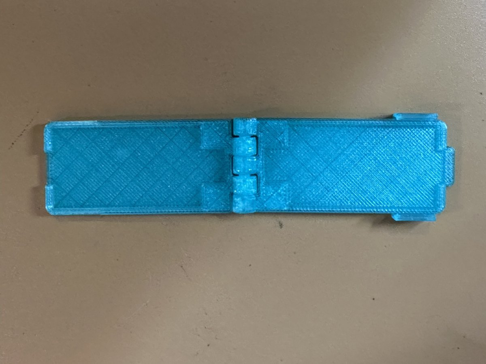
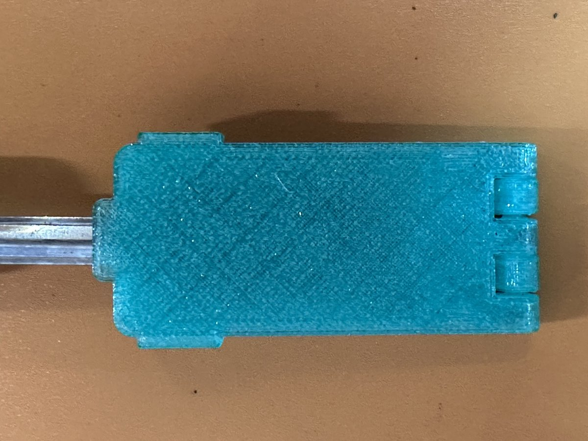
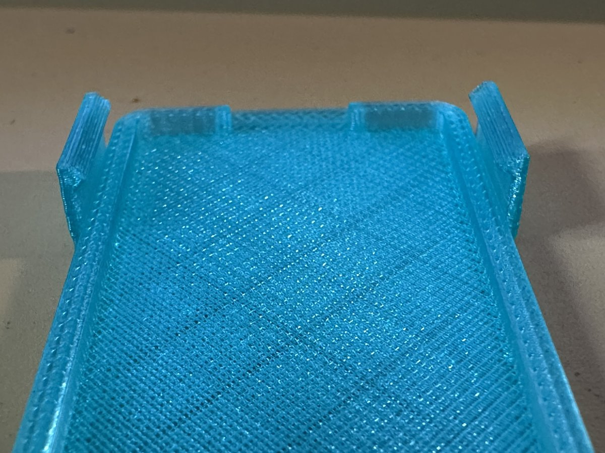

# Bread Lame Blade Cover

A folding, snap-shut safety cover for a bread lame — the kind that holds a
standard double-edged razor blade on a flat steel strip. It prints in one
piece, flat and open, with a print-in-place hinge and no supports. Fold it
over the blade and it snaps shut; flip the thumb lip to open it.

The model is a single parametric OpenSCAD file, so it can be adjusted for
other lames and other printers.

| As printed | Closed | Latch tabs |
|---|---|---|
|  |  |  |

## Features

- **Print-in-place pin hinge** at the blade-tip end: five knuckles, pin
  fused to one half and free in the other.
- **Enclosed blade pocket** (44.5 × 24 mm, 3 mm deep overall) with room for
  the blade's bow and for the strip tip that sticks out past the blade.
- **Strip exit notch** at the handle end, so the cover closes around the
  strip without clamping it.
- **Two positive snap latches** near the handle end, plus a **thumb lip**
  for opening.
- No supports, no assembly, no hardware.

Closed size is about 59 × 31 × 7 mm; the print layout is about
122 × 31 × 7 mm.

## Files

| File | Purpose |
|---|---|
| `lame_cover.scad` | The parametric model (plain OpenSCAD, no libraries) |
| `stl/lame_cover.stl` | Ready-to-print STL at the default parameters, laid out open |
| `docs/USER_MANUAL.md` | Printing, use, fitting and parameter reference |
| `images/` | Photos of the printed part and OpenSCAD renders |

## Quick start

1. Print `stl/lame_cover.stl` as-is, flat on the bed, no supports.
   PETG is recommended; the prototype was printed in translucent PETG.
2. Work the hinge back and forth a few times to free it.
3. Lay the blade in the bottom pocket with the strip in the notch, fold the
   top over, and press until both latches click.

See the [User's Manual](docs/USER_MANUAL.md) for details, and for how to
fit the cover to a different lame.

## Status

Version 0.1.0. The prototype has been printed and used: the hinge is
secure, the latches are positive and release easily with the thumb lip,
and the cover sits loosely on the strip, which is intended (no stress on
the blade or latches).

## Credits and license

Designed and written by Claude (Anthropic) at the direction of
Bob Drzyzgula, who specified the requirements, printed and tested the
prototype, and maintains the repository.

Released under the [MIT License](LICENSE).
