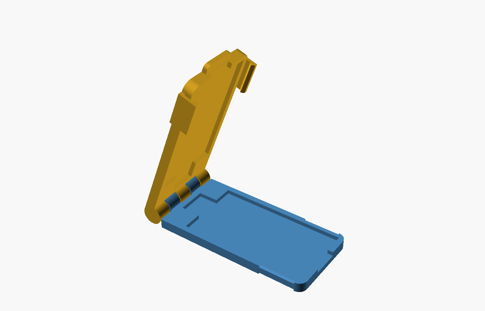
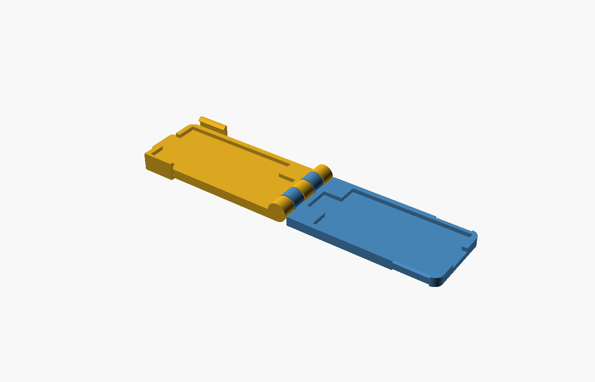
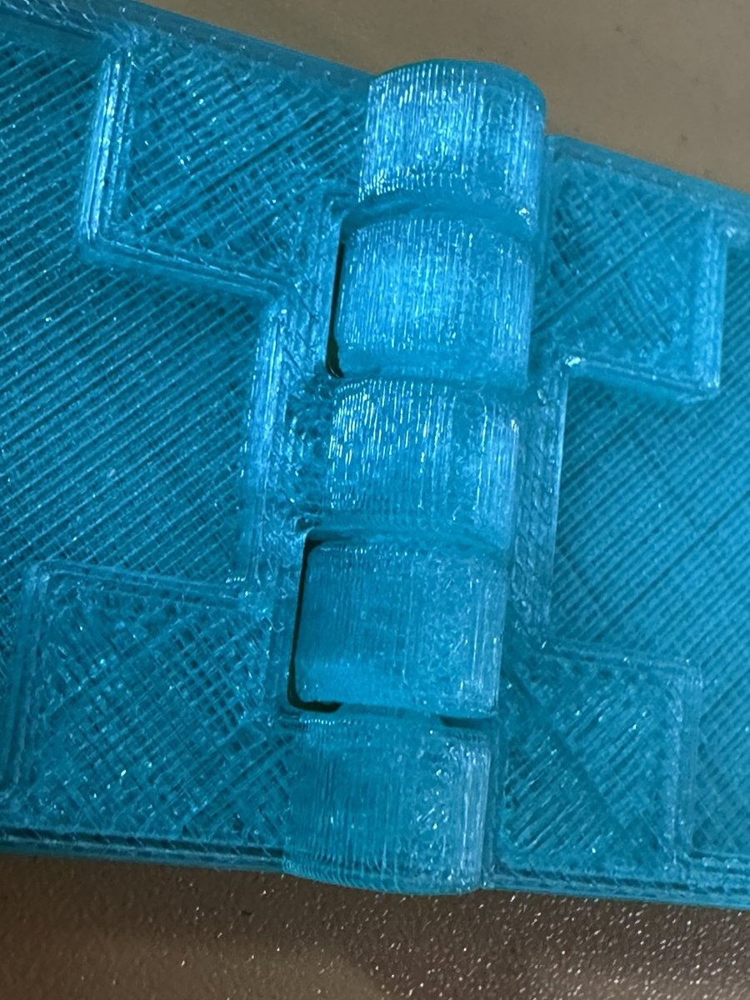

# Bread Lame Blade Cover — User's Manual

Version 0.1.0

Written by Claude (Anthropic) at the direction of Bob Drzyzgula.

## 1. What it is

The cover is a two-piece clamshell joined by a hinge at the blade-tip end.
The bottom half holds the blade in a shallow pocket; the top half folds
over it and snaps shut. A notch in the handle-end wall lets the lame's
steel strip pass out of the cover, so the cover can be closed while the
blade is still mounted.

The cover is meant to make the lame safe to keep in a drawer. It is
intentionally a loose fit on the strip: it doesn't clamp the blade or the
strip, so neither the blade nor the latches carry any load while it is
stored.

### Parts of the cover

- **Bottom half** — the half without latch tabs. Holds the blade.
- **Top half** — carries the two latch tabs and the thumb lip.
- **Hinge** — five knuckles at the tip end. The top half owns the two
  outer knuckles, the center knuckle and the pin; the bottom half's two knuckles
  turn on the pin.
- **Blade pocket** — 44.5 × 24 mm, split 1.5 mm deep in each half (3 mm
  total), for a standard 43 × 22 mm double-edged blade with up to about
  2 mm of bow.
- **Tip pocket** — a 10 × 7 mm extension of the pocket at the hinge end,
  for the end of the strip that sticks out past the blade.
- **Strip notch** — a 9.5 mm wide opening through the handle-end wall.
- **Latch tabs** — one on each side of the top half, near the handle end.
  Each tab is attached only at the top skin, so it can spring outward. A
  bead on its inner face snaps into a recess in the bottom half's side
  wall.
- **Thumb lip** — a small ledge on the top half, past the handle end, for
  flipping the cover open.

## 2. Printing

- **File:** `stl/lame_cover.stl`, or export your own from
  `lame_cover.scad` with `fold_angle = 0`.
- **Orientation:** as exported — flat on the bed, both halves cavity-up,
  hinge in the middle. Don't rotate it.
- **Supports:** none. All overhangs are 45° or bridged.
- **Material:** PETG is recommended, because the latch tabs flex every
  time the cover opens and closes. The prototype was printed in
  translucent PETG. PLA will probably work, but the tabs will be stiffer
  and more brittle.
- **Footprint:** about 122 × 31 mm, 7 mm tall at the hinge knuckles.
- **Brim:** not normally needed. If you use one, make sure it doesn't
  bridge the gap between the two halves at the hinge.
- **Elephant's foot:** if your printer has a lot of first-layer squish,
  check the hinge knuckles, which touch the bed along a line, and the gap
  between the latch tabs and the top half's side walls.

### After printing

1. Let the part cool fully on the bed.
2. Holding one half in each hand, fold the hinge slowly a few times
   through its full travel to break it free. The pin is printed inside
   the bottom half's knuckles with 0.4 mm clearance; a first bit of
   stiffness is normal.
3. Check that the latch tabs move freely and nothing is fused between
   the tabs and the side walls.

## 3. Using the cover

### To put it on

1. Open the cover fully.
2. Lay the lame on the bottom half — the one *without* latch tabs — with
   the blade in the pocket, the strip tip toward the hinge, and the strip
   running out through the notch at the handle end.
3. Fold the top half over until it rests on the blade.
4. Press down near the handle end until both latches click. Each tab
   should be seated in its recess.

### To take it off

1. Hold the bottom half (or the lame handle).
2. Lift the thumb lip with a thumbnail or fingertip; the latches release
   together.
3. Fold the top half back and lift the lame out.

### Notes

- The cover is loose on the strip and will shift a little when it's on.
  That is by design.
- Close the cover only over a properly mounted blade. The pocket is sized
  for the blade, not for loose blades rattling around inside.
- The translucent PETG prototype lets you see the blade inside, which
  makes it easy to confirm the blade is seated before you close the cover.

## 4. Fitting it to a different lame

Every dimension is a parameter in `lame_cover.scad`. Open the file in
OpenSCAD and use the Customizer (Window → Customizer), or edit the values
at the top of the file. Every parameter has a range and step, so the
Customizer keeps decimals.

Set `fold_angle` to preview the cover at any angle from 0 (print layout)
to 180 (closed); it only affects the preview, but set it back to 0 before
exporting an STL for printing.

### What to measure

1. **Blade size.** Standard double-edged blades are 43 × 22 mm. If yours
   is different, set `blade_len` and `blade_wid` about 1.5–2 mm larger
   than the blade.
2. **Thickness.** Measure the thickest point, across the blade's bow and
   across the strip. Set `cavity_t` to that plus about 1 mm.
3. **Strip tip.** Measure how far the end of the strip projects beyond the
   end of the blade, and how wide it is. Set `tip_len` and `tip_wid` a
   little larger.
4. **Strip width.** Set `shaft_wid` to the strip width plus about 1.5 mm.

### Parameter reference

**View**

| Parameter | Default | Meaning |
|---|---|---|
| `fold_angle` | 0 | 0 = print layout, 180 = closed (preview only) |

**Blade and strip**

| Parameter | Default | Meaning |
|---|---|---|
| `blade_len` | 44.5 | Blade pocket length |
| `blade_wid` | 24.0 | Blade pocket width |
| `cavity_t` | 3.0 | Total pocket depth, both halves together |
| `tip_len` | 7.0 | Strip-tip pocket length past the blade |
| `tip_wid` | 10.0 | Strip-tip pocket width |
| `shaft_wid` | 9.5 | Strip exit notch width |

**Shell**

| Parameter | Default | Meaning |
|---|---|---|
| `H` | 3.5 | Height of each half; also the knuckle radius |
| `wall` | 2.0 | Side wall thickness |
| `end_wall` | 2.0 | End wall thickness |
| `corner_r` | 3.0 | Corner radius at the handle end |

**Hinge**

| Parameter | Default | Meaning |
|---|---|---|
| `n_knuckles` | 5 | Number of knuckles (odd) |
| `pin_r` | 1.6 | Pin radius |
| `pin_clear` | 0.4 | Radial clearance around the pin |
| `knuckle_gap` | 0.4 | Axial gap between knuckles |
| `hinge_clear` | 0.4 | Gap between a knuckle and the other half's end face |

**Latch**

| Parameter | Default | Meaning |
|---|---|---|
| `tab_len` | 12 | Latch tab length along the cover |
| `tab_t` | 1.0 | Tab thickness (thinner = easier snap) |
| `tab_slot` | 0.6 | Slot between tab and the top half's side wall |
| `snap_intf` | 0.4 | How far the bead rides over the bottom half's wall |
| `recess_extra` | 0.15 | Extra recess depth beyond the interference |
| `tab_root` | 1.2 | Thickness of the tab's root in the top skin |
| `lip_len` | 3.0 | Thumb lip length past the handle end (0 = none) |
| `lip_wid` | 12 | Thumb lip width |

Several values are derived from these, including the case length and
width, knuckle widths, the latch window position and the recess height.
They are computed at the top of the file, after the parameters.

## 5. Troubleshooting

| Symptom | Likely cause | Adjustment |
|---|---|---|
| Hinge fused or very stiff after printing | Pin clearance too small for your printer | Raise `pin_clear` to 0.45–0.5; also try `knuckle_gap` 0.5 |
| Hinge sloppy | Clearance larger than needed | Lower `pin_clear` to 0.3–0.35 |
| Latch too hard to close or open | Too much interference, or tab too stiff | Lower `snap_intf` (e.g. 0.3) or `tab_t` (e.g. 0.8) |
| Latch doesn't hold | Too little interference | Raise `snap_intf` (e.g. 0.5) |
| Tab fused to the side wall | Slot too narrow for your nozzle and settings | Raise `tab_slot` to 0.7–0.8 |
| Tab cracks at its root | Brittle material or too much flex | Print in PETG; lower `snap_intf`; raise `tab_root` |
| Cover won't close over the blade | Pocket too shallow for the bow, or tip pocket too short | Raise `cavity_t`; re-measure the strip tip and raise `tip_len` |

## 6. How the hinge works

The cover prints flat, and the hinge axis lies in the mating plane between
the two halves, at the height of the halves' top surfaces as printed. Each
knuckle is a cylinder of radius `H` around that axis, so the knuckles just
touch the bed. Folding the top half 180° around the axis puts its mating
face exactly on the bottom half's mating face.

Each half's end face sits `hinge_clear` beyond the other half's knuckles,
so neither half's body touches the other's knuckles anywhere in the swing.
The model was checked for collisions at intervals through the full 180°.
The only contact before closing is the latch beads riding over the bottom
half's wall in the last couple of degrees, which is the snap.

## 7. License

MIT — see [LICENSE](../LICENSE).
